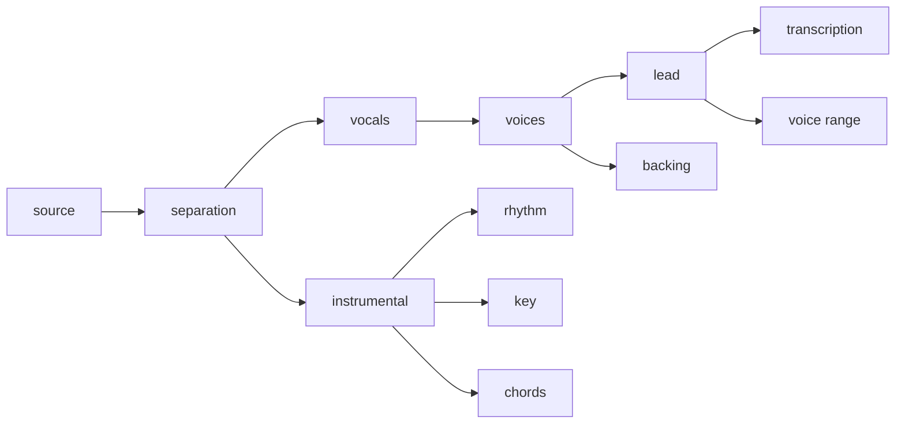

# The product

Musetric is for singers and musicians, amateurs and teachers with their
students: it takes a song apart and helps to learn it and to sing it. It is
one application for Windows, macOS, Android and iOS; Linux is not supported
yet ([R-6](decisions/r06-linux-not-supported-yet.md)). A Tauri
shell runs the Rust host and shows the React
interface in the platform's WebView, and the models run on WebGPU in a web
page, the same way everywhere. How each part works is in the source and the
readmes of [musetric/musetric](https://github.com/musetric/musetric); where the
models run and what each platform does to them is in
[environment/platforms.md](environment/platforms.md).

## How it is built

- **The app** (`packages/app`) is a Tauri shell, the same on every platform.
  It runs the Rust host in its own process and shows the interface in the
  platform's WebView.
- **The host** (`packages/server`) owns the data and the processing: the
  SQLite database, the files of the projects, decoding and encoding audio, the
  processing queue, mixdown and export
  ([R-10](decisions/r10-host-owns-processing.md),
  [R-14](decisions/r14-media-without-ffmpeg.md)). It serves the interface and
  its API on the device's loopback address.
- **The interface** (`packages/frontend`, with `packages/engine` and
  `packages/audio`) plays, draws and records in the WebView.
- **The executor** is a hidden page of the app that runs the models
  (`packages/ai`). It connects to the host by itself on a loopback port of its
  own and takes one unit of work at a time
  ([R-4](decisions/r04-executor-connects-itself.md),
  [R-20](decisions/r20-one-inference-at-a-time.md)).

## What happens to a song

A song is processed by seven steps, each reading what an earlier step made:

Separation splits the vocals from the instrumental, and voices splits the lead
from the backing. Transcription writes the lyrics with the time of each word,
voice range finds the range of the lead, rhythm finds the beats, the downbeats
and the tempo, and key and chords read the instrumental. A step that is
interrupted resumes from its last checkpoint.

## What it keeps

Everything stays on the device: the song, its stems and analyses, and the
user's recordings. The stems and analyses can be computed again from the song;
a recording cannot, so it is never treated as a cache. The models are
downloaded once from Hugging Face, and the host checks each file against the
size and SHA-256 it pins.

## The models

| Step | Model | Licence of the weights | Repository |
| --- | --- | --- | --- |
| Separation | Mel-Band RoFormer Duality by Aname ([R-28](decisions/r28-vocal-model-duality.md)) | Apache-2.0 | `musetric/aname-mel-band-roformer-duality-onnx` |
| Voices | MDX-Net KARA2 of Ultimate Vocal Remover | MIT | `musetric/uvr-mdxnet-kara2-onnx` |
| Transcription | Whisper large-v3 turbo by OpenAI ([R-26](decisions/r26-whisper-on-transformers-js.md)) | MIT | `musetric/whisper-large-v3-turbo-onnx` |
| Rhythm | Beat This! by CPJKU | MIT | `musetric/beat-this-onnx` |
| Key | S-KEY by Deezer | MIT | `musetric/skey-onnx` |
| Chords | ChordNet of ChordMini | MIT | `musetric/chordmini-onnx` |
| Voice range | no model: the pitch tracker of `@musetric/spectrogram` | | |

The revision of each model is pinned in musetric's
`packages/server/src/analysis/models.rs`, at the head of its repository's
`main` ([practices/models.md](practices/models.md)).

## Where it stands

Musetric is preparing its first release; nothing has been released yet. The
release is the goal of
[musetric/musetric#1099](https://github.com/musetric/musetric/issues/1099),
and it waits on three things:

- **Correct results on phones.** The defects of mobile GPUs are worked around
  one by one ([#975](https://github.com/musetric/musetric/issues/975)), and
  no check yet follows a step from the original model to the result on a
  phone ([#972](https://github.com/musetric/musetric/issues/972)).
- **Processing that fits the device.** On the iPhone the models do not fit
  in the memory the page may use
  ([#1088](https://github.com/musetric/musetric/issues/1088)), macOS restarts
  processing in a loop
  ([#1052](https://github.com/musetric/musetric/issues/1052)), and processing
  must become several times faster without losing quality
  ([#1080](https://github.com/musetric/musetric/issues/1080)) while the phone
  stays responsive
  ([#957](https://github.com/musetric/musetric/issues/957)) and within its
  memory ([#958](https://github.com/musetric/musetric/issues/958)).
- **The release itself.** No build has been published, installed and updated
  yet ([#1100](https://github.com/musetric/musetric/issues/1100)), the macOS
  build is not signed
  ([#1101](https://github.com/musetric/musetric/issues/1101)), and the site
  neither offers the app nor lets a visitor try it in the browser
  ([#1115](https://github.com/musetric/musetric/issues/1115),
  [R-39](decisions/r39-browser-version-is-the-site.md)).
