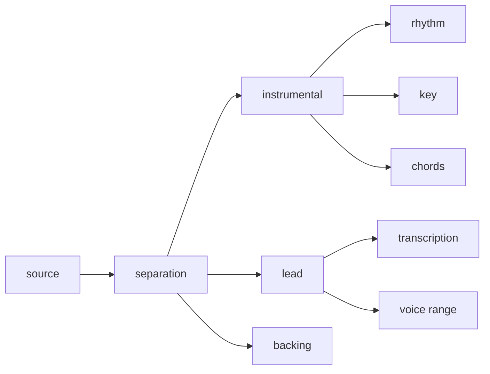

# The product

Musetric is for singers and musicians, amateurs and teachers with their
students: it takes a song apart and helps to learn it and to sing it. It
follows the [principles](principles.md) in every part. This page is the
product's model: its concepts and their names, how it is built, where it runs,
where it stands and where it goes. What it states is required of the code;
how each part works is in the source and the readmes of
[musetric/musetric](https://github.com/musetric/musetric).

## Concepts

The words of the product, the same in the interface, the documents and the
code ([design.md](practices/design.md#domain-driven-design)).

- **Song**: the audio a user brings; everything else is made from it.
- **Stems**: the song taken apart, the vocals and the instrumental, and the
  vocals further into the lead and the backing.
- **Steps**: the processing that makes the stems and the analyses of a song,
  in [What happens to a song](#what-happens-to-a-song).
- **Lyrics and lines**: transcription writes the lyrics with the time of each
  word; a line of the lyrics is what a user practises.
- **Take**: what the user sings in one pass of recording. A user sings and
  records at any tempo and in any key of the song, since slowing down,
  singing and speeding up again is the core of practice; a take sung in
  another key sounds in the song's current key.
- **Recording**: the user's singing over the song, built from takes, a newer
  take over an older one, with its own undo and redo. A song keeps several
  named recordings, so that parts, tempos and tries are practised without one
  overwriting another. Exactly one is active: it plays, it is shown, and new
  takes go into it. The last one is never deleted.
- **Loop and tries**: a line plays again and again, and each pass records a
  try. The tries are compared, and leaving the loop puts the chosen try into
  the recording or drops them all, so that practice on one phrase feeds the
  recording without its weaker tries. Playing a range of the song, once or in
  a cycle, belongs to the player and serves more than the loop.
- **Key, tempo and octave**: the key moves by semitones, up to six up or
  down, and by an octave up or down. The octave does not shift the sound,
  since every way tried to shift a whole mix by an octave distorted it: it
  moves the singer's line in the picture and in the comparison, so that a
  user can sing an octave away and still see whether they hit the notes. Only
  the lead voice is concerned; the backing and the instrumental never move by
  an octave.
- **Notes**: the view that compares a take with the singer's real pitch line
  in cents, not rounded to the semitone. The line is split into notes, so
  that the gestures at their edges, such as a scoop, an overshoot, a fall or
  the onset of vibrato, belong to their note, and no written score is needed:
  rounding would hide what makes a student's singing differ from the
  singer's.
- **Export**: a file of the mix, the key and the tempo the user hears, which
  can be changed in the export the same way as in the player.

## How it is built

- **The app** (`packages/app`) is a Tauri shell, the same on every platform.
  It runs the Rust host in its own process and shows the interface in the
  platform's WebView.
- **The host** (`packages/server`) owns the data and the processing, being
  the one part that outlives a reload, a crash or a closed app: the SQLite
  database, the files of the songs, decoding and encoding audio with its own
  code and no external program, the processing queue, mixdown and export. It
  plans the units of a step, hands the executor one unit at a time, keeps a
  checkpoint every few units and resumes from it. It serves the interface on
  the device's loopback address; data moves over HTTP, commands and progress
  over a WebSocket.
- **The interface** (`packages/frontend`, with `packages/engine` and
  `packages/audio`) plays, draws and records in the WebView.
- **The executor** (`packages/ai`) is a hidden page of the app that connects
  to the host by itself, so that a reload of the interface neither drops the
  running step nor loads its model again. Every model runs in it, through
  onnxruntime-web and the product's own shaders, never natively, and exactly
  one neural network runs at any moment; the next model may load while
  another computes.
- **On a phone** processing runs only while the app is on screen, with the
  screen kept on: Android may end an app that has left the screen, and iOS
  gives no background time for such work.

## What happens to a song

A song is processed by six steps, each reading what an earlier step made:

Separation splits the song into the instrumental, the lead and the backing in
one pass of one model; the vocals, the lead and the backing together, stay
internal. Transcription writes
the lyrics with the time of each word, voice range finds the range of the
lead, rhythm finds the beats, the downbeats and the tempo, and key and chords
read the instrumental.

## What it keeps

Everything stays on the device: the song, its stems and analyses, and the
user's recordings. The stems and analyses can be computed again from the song;
a recording cannot, so it is never treated as a cache. The models are
downloaded once from Hugging Face, and the host checks each file against the
size and SHA-256 it pins.

## The models

| Step | Model | Licence of the weights | Repository |
| --- | --- | --- | --- |
| Separation | Mel-Band RoFormer student of Duality by Aname and of KARA 2 of Ultimate Vocal Remover | Apache-2.0 | `musetric/mel-band-roformer-duality-kara2-student-onnx` |
| Transcription | Whisper large-v3 turbo by OpenAI | MIT | `musetric/whisper-large-v3-turbo-onnx` |
| Rhythm | Beat This! by CPJKU | MIT | `musetric/beat-this-onnx` |
| Key | S-KEY by Deezer | MIT | `musetric/skey-onnx` |
| Chords | ChordNet of ChordMini | MIT | `musetric/chordmini-onnx` |
| Voice range | no model: the pitch tracker of `@musetric/spectrogram` | | |

How a model is chosen, replaced, published and pinned is in
[practices/models.md](practices/models.md).

## Where it runs

Windows, macOS, Android and iOS. Apple systems are supported from version 26,
the first whose WebView has WebGPU, and the app refuses to install on an
older one. Linux is built but not supported until its executor can run the
models, since its WebView has no WebGPU the product can rely on. What each
kind of platform does to the models is in
[environment/platforms.md](environment/platforms.md).

## Where it stands

Musetric is preparing its first release; nothing has been released yet. The
release is the goal of
[musetric/musetric#1099](https://github.com/musetric/musetric/issues/1099),
and it waits on three things:

- **Correct results on phones.** The defects of mobile GPUs are worked around
  one by one ([#975](https://github.com/musetric/musetric/issues/975)), and
  no check yet follows a step from the original model to the result on a
  phone ([#972](https://github.com/musetric/musetric/issues/972)).
- **Processing that fits the device.** On the iPhone the models do not fit
  in the memory the page may use
  ([#1088](https://github.com/musetric/musetric/issues/1088)), macOS restarts
  processing in a loop
  ([#1052](https://github.com/musetric/musetric/issues/1052)), and processing
  must become several times faster without losing quality
  ([#1080](https://github.com/musetric/musetric/issues/1080)) while the phone
  stays responsive
  ([#957](https://github.com/musetric/musetric/issues/957)) and within its
  memory ([#958](https://github.com/musetric/musetric/issues/958)).
- **The release itself.** No build has been published, installed and updated
  yet ([#1100](https://github.com/musetric/musetric/issues/1100)), the macOS
  build is not signed
  ([#1101](https://github.com/musetric/musetric/issues/1101)), and the site
  neither offers the app nor lets a visitor try it in the browser
  ([#1115](https://github.com/musetric/musetric/issues/1115)).

## Where it goes

- **The trainer** leads an amateur the way a teacher does, through the
  spectrogram ([#1131](https://github.com/musetric/musetric/issues/1131)). It
  finds the hard phrases of a song, shows the one place where the student
  sang differently from the singer, the two side by side, lets the student
  hear it, and has them sing exactly that phrase again. A concept of the
  picture, such as pitch, timing, breath, gestures or vibrato, is explained
  the first time it appears in the student's singing. It never gives a score,
  a percentage or a similarity in place of the picture and an action, and
  shows no hints or verdicts while the student sings: an amateur cannot judge
  their own singing, and neither a raw picture nor a number says what to
  change, while one explained goal on a short piece does.
- **The browser version is the site**
  ([#1115](https://github.com/musetric/musetric/issues/1115)): a visitor tries
  Musetric with nothing installed and no server that receives the song.
  Musetric's packages are published to npm as libraries of algorithms and
  inference, without the DOM, and the site builds its own pages on them. No
  Rust runs in the browser, so what the host does for a step and the site
  needs is done in TypeScript in the package.
